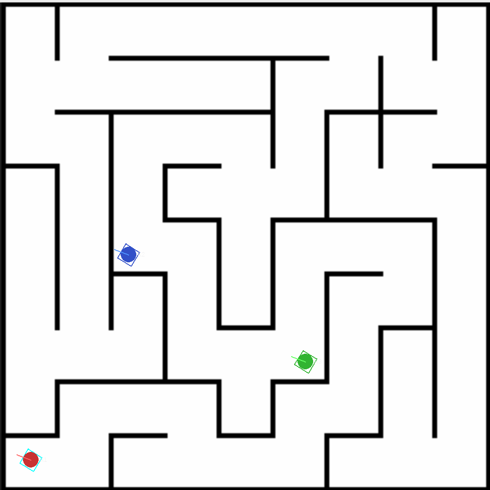
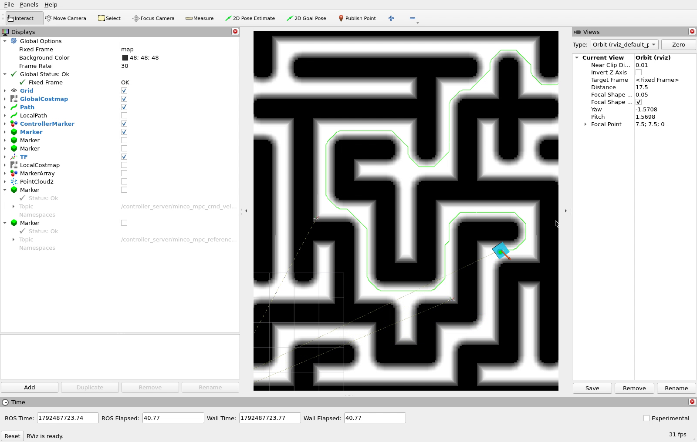
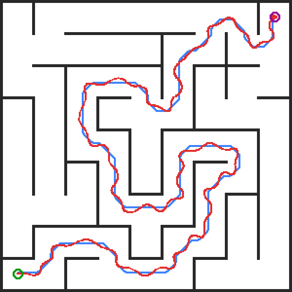

# 27 算法组导航方向招新大作业 —— 全局规划 + 全向底盘路径跟踪

> **交付版本：基础版** —— 控制器默认使用第 4 章的全向底盘纯跟踪（`fine_traj: false`），六轮实测到达 60–69 s、终点误差均小于 0.09 m。

在给定的迷宫地图上完成「一次点击导航」全流程：
**RViz 点一个终点 → 上层行为树触发导航 → A\* 规划全局路径 → 本仓库实现的控制器插件跟踪路径 → 小车平稳到达终点。**

本仓库在发放框架上完成了两件事（对应作业要求里"必须完成的工作"）：

1. **实现路径跟踪控制器插件** —— `sp_controller_server/plugins/pid_controller.cpp`
   （`configure` / `setPlan` / `computeVelocityCommands` 三个接口）；
2. **补全运行所需参数** —— `sp_nav_bringup/config/nav_params.yaml`
   （ESDF / 规划器 / 控制器三组参数原本全为空，直接运行会因 `[参数缺失]` 抛异常退出）。

另外把两条**加分项**也都写了实现并做了消融实验（轨迹平滑、LQR 控制器，见[第 10 章](#10-加分项轨迹平滑与-lqr消融实验)）；
实测下来它们的「稳定性」都没赢过默认版本，所以默认配置保持不变，加分项以可选开关的形式保留。

> 仿真器、全局规划、行为树、决策等发放代码**未做修改**，只改了控制器插件、参数文件、RViz 配置与本文档。

---

## 1. 系统架构与数据流

```
                     RViz "2D Goal Pose"
                             │ /goal_pose
                             ▼
   ┌──────────────────────────────────────────┐
   │ sp_decision  上层行为树 click_nav.xml     │
   └──────────────────┬───────────────────────┘
                      │ NavigateToPose (Action)
                      ▼
   ┌──────────────────────────────────────────┐
   │ sp_nav_bt  下层行为树                     │  20Hz 取位姿，10Hz 重规划，
   │ default_nav_with_fallback.xml             │  剩距 <0.3m 判定到达
   └───────┬───────────────────────┬──────────┘
           │ make_plan (srv)        │ set_control_enable (srv)
           ▼                        ▼
 ┌───────────────────┐      ┌────────────────────────────┐
 │ sp_global_planner │      │ sp_controller_server       │
 │ A* → /global_path │─────▶│ 加载 PidController 插件    │
 └─────────▲─────────┘      │ 50Hz 计算 cmd_vel          │
           │ /global_costmap │                            │
           │ /local_costmap  └──────────┬─────────────────┘
 ┌─────────┴─────────┐                 │ /sentry/cmd_vel
 │ sp_map_server     │      ┌──────────▼─────────────────┐
 │ ESDF 代价地图     │      │ sp_nav_sim 拖拽仿真        │
 └───────────────────┘      │ /Odometry + TF             │
                            └────────────────────────────┘
```

* TF：`map --(静态)--> lidar_odom --(动态)--> base_link`
* 控制器输出 `TwistStamped`（`base_link` 系），`controller_server` 取 `twist` 发布到 `/sentry/cmd_vel`。
  全向底盘只吃 `linear.x / linear.y`，故 `angular.z` 恒为 0。

## 2. 环境与编译

```bash
# Ubuntu 22.04 + ROS 2 Humble
sudo apt update
sudo apt install -y python3-colcon-common-extensions python3-rosdep \
  ros-humble-pluginlib ros-humble-tf2-ros ros-humble-tf2-geometry-msgs \
  ros-humble-nav-msgs ros-humble-std-srvs ros-humble-rviz2 \
  ros-humble-behaviortree-cpp-v3 qtbase5-dev libopencv-dev libyaml-cpp-dev
pip3 install --user pygame numpy Pillow

cd <仓库根目录>
colcon build --symlink-install && source install/setup.bash
```

## 3. 运行

```bash
# 终端 1：静态 TF
ros2 run tf2_ros static_transform_publisher 0 0.15 0 0 0 0 base_link livox_frame
# 终端 2：代价地图 + 规划 + 控制器 + 决策 + 行为树 + RViz
ros2 launch sp_nav_bringup sp_nav.launch.py
# 终端 3：仿真器（等 3 秒）
ros2 launch sp_nav_sim sim_robot.launch.py
```
或 `bash bash/sim_nav_all_start.sh` 一次拉起。

**评测操作**：RViz 工具栏选 `2D Goal Pose`，点击终点 **(14.1, 14.1)**（只点一次）。

---

## 4. 控制器实现（核心）

### 4.1 先把底盘能力量出来

调参之前先写脚本直接给 `/sentry/cmd_vel` 打阶跃、读 `/Odometry`，量出底盘的物理边界：

| 指标 | 实测值 | 对控制的影响 |
|---|---|---|
| 稳态可达线速度 | **≈1.38 m/s** | 轮速上限 2.0 被"小陀螺"自旋的 ω×0.2=0.6 m/s 占掉一块，指令给再大也没用 |
| 速度矢量转向能力 | **p90 ≈2.8 rad/s** | 指令方向转速超过它，底盘追不上 → 画龙 |
| 速度响应滞后 | ≈0.1–0.15 s | 纯跟踪会因此产生极限环摆动 |
| 车体自旋包络 | 半对角线 0.354 m | 离墙必须 >0.35 m，否则边转边蹭 |

这些数字直接决定了后面的参数取值范围。

### 4.2 四个关键设计

**(1) 稳定参考路径 + 进度索引**（最关键的一处改动）

上层行为树每 100 ms 用**当前栅格中心**作起点重规划一次。如果控制器每次都采信这条新路径，前视点会在相邻两个栅格中心之间来回跳（±5 cm ≈ ±10° 方向噪声），喂给一个有滞后的底盘就是持续摆动。

因此控制器把**第一次规划的路径固化为参考路径**，之后的重规划只有在"偏离超过 `ref_dev_tol`（默认 0.60 m，说明真的换了路线）"时才替换；投影时只在进度索引附近（前 6 m / 后 1 m）窗口搜索，既快又不会跳到路径的另一段。

**(2) 曲率限速 + 刹车反传的速度剖面**

$$
\kappa_i=\frac{|\Delta\theta_i|}{\tfrac12(l_{i-1}+l_i)},\qquad
v^{\text{lat}}_i=\min\left(v_{\max},\ \sqrt{a_{\text{lat}}/\kappa_i}\right)
$$

$$
v_i=\min\left(v^{\text{lat}}_i,\ \sqrt{v_{i+1}^{2}+2a_{\text{dec}}\Delta s_i}\right),\qquad v_{\text{end}}=0
$$

弯道按 `a_lat` 限速，再用刹车约束从终点反向传播，保证每一点都来得及减速，末端自然收敛停车。
路径先做 2 次 `[1/4, 1/2, 1/4]` 平滑，把栅格的直角弯圆角化。

**(3) 纯跟踪 + 滞后预测**

取路径前方 `L = clamp(0.30 + 0.15v, 0.30, 0.50)` 处的引导点，方向指向它；
控制点不直接用当前位姿，而是用实测速度前推 `predict_dt = 0.15 s`：

$$
p_{\text{ctrl}} = p + v_{\text{meas}}\cdot \Delta t_{\text{pred}}
$$

这一项补偿掉底盘的速度响应滞后，实测平均跟踪误差从 0.139 m 降到 0.095 m。

**(4) 卡住脱困（兜底）**
命令 >0.5 m/s 而实测 <0.08 m/s 持续 2 s → 沿路径反方向倒车 0.9 s；**一次任务最多 3 次**，防止"蹭墙→倒车→再蹭"的死循环。

最后把 map 系速度旋到车体系：`vx_b = cos(yaw)*ux + sin(yaw)*uy`，`vy_b = -sin(yaw)*ux + cos(yaw)*uy`。
`yaw` 每周期都从 TF 重读（仿真里云台以 1 rad/s 匀速扫描，缓存 yaw 会直接跑飞）。

### 4.3 调参踩过的坑

| 尝试 | 结果 | 原因 |
|---|---|---|
| 前视距离大、`a_lat=6` 全速过弯 | 约 56 s，但切弯贴墙（离墙 0.32 m）、偶发卡死 | 实际转弯半径 = v/ω 大于路径半径，必然切角 |
| 加横向误差 P（k=1.5） | 105 s、7 次卡死 | 与纯跟踪叠加，过增益振荡 |
| 加横向速度 D（k=0.6） | 102 s、9 次卡死 | 实测速度本身滞后 0.1 s，D 变成反阻尼 |
| `a_lat` 调到 1.2 太保守 | 150 s 没到终点 | 长时间低速贴墙，反复触发脱困 |
| **纯跟踪 + 滞后预测（最终）** | **60–69 s（中位 64 s），离墙 ≥0.30 m，六轮 0 碰撞** | — |

### 4.4 参数一览

| 参数 | 值 | 含义 |
|---|---|---|
| `max_linear_vel` | 1.35 m/s | 实测底盘上限 1.38，不贪 |
| `lat_acc` | 1.8 m/s² | 过弯向心加速度（过弯速度 ≈√(a_lat·R)） |
| `dec_acc` | 1.2 m/s² | 速度剖面刹车减速度 |
| `lookahead_min/max/gain` | 0.30 / 0.50 / 0.15 | 前视距离 `min + gain·v` |
| `predict_dt` | 0.15 s | 滞后预测时间 |
| `ref_dev_tol` | 0.60 m | 换参考路径的偏离阈值 |
| `lat_gain` / `lat_damp` | 0 / 0 | 横向 PD（实测有害，默认关） |
| `goal_tolerance` | 0.05 m | 终点停车阈值 |

---

## 5. 参数补全说明（原本全是空的）

| 节点 | 参数 | 值 | 为什么 |
|---|---|---|---|
| esdf | `map_yaml` | `sp_nav_bringup/map/maze_map.yaml` | 评测地图 |
| esdf | `robot_radius` / `margin` | 0.25 / 0.10 | 车体半边长 0.25，留 0.10 余量 |
| esdf | `d_safe` / `w` | 0.70 / 12.0 | 软代价让路径尽量走通道中线 |
| planner | `costmap_topic` | `/global_costmap` | ESDF 全图代价地图 |
| planner | `local_costmap_topic` | `/local_costmap/costmap` | 仿真 4m×4m 局部图，取 max 融合 |
| planner | `path_topic` | `/global_path` | 与控制器订阅一致 |
| planner | `plugin_type` | `sp_global_planner/AStarPlanner` | pluginlib 类名 |
| planner | `AStar.lethal_cost/cost_weight` | 100 / 2.0 | cost≥100 不可通行 |
| controller | `local_path_topic` | `/global_path` | 与规划输出一致 |
| controller | `odom_topic` / `odom_frame_id` | `/Odometry` / `lidar_odom` | 仿真实际话题与坐标系 |
| controller | `cmd_vel_topic` | `/sentry/cmd_vel` | 仿真订阅的底盘速度话题 |
| controller | `control_frequency` | 50 Hz | 比仿真 30Hz 积分更快，控制不拖拍 |

---

## 6. 可视化

* **全局代价地图** `/global_costmap` + 局部代价地图 `/local_costmap/costmap`
* **全局路径** `/global_path`
* **机器人位姿**：TF（`map / lidar_odom / base_link`）+ `/controller_marker` 里的青色车体方块
* **控制输出**：`/controller_marker` 橙色箭头（当前指令速度方向与大小）
* **起终点**：`/plan_markers` 的红球（终点）、绿球（起点）

> 发放的 RViz 配置里有一批原 RM 项目遗留显示项（`/MincoLocalPlanner/*`、`/filtered_cloud`、
> `/dynamic_obstacles/*`）在本工程没有数据源，已置 `Enabled: false`，面板保持干净。

<p align="center">
  
  
</p>
<p align="center">
左：仿真器俯视（红 = 受控哨兵，蓝 / 绿 = 两个陪跑机器人）　
右：RViz（浅色为通道，深色为墙体与代价膨胀区，绿色细线为全局路径，青色方块为车体）
</p>

## 7. 结果

地图 `maze_map`（15×15 m，通道约 1.5 m），起点 `(0.9,0.9)` → 终点 `(14.1,14.1)`，全局路径约 **49.1 m**。
按评分口径用脚本自动跑（自动发一次 `/goal_pose`，TF 采位姿，按首次全局路径算跟踪误差）：

| 轮次 | 到达用时 | 终点误差 | 跟踪误差均值 | p95 | 离墙最小余量 | 卡住次数 |
|---|---|---|---|---|---|---|
| 1 | 60.3 s | 0.059 m | 0.095 m | 0.215 m | 0.42 m | 0 |
| 2 | 62.9 s | 0.031 m | 0.102 m | 0.232 m | 0.39 m | 0 |
| 3 | 63.4 s | 0.061 m | 0.111 m | 0.256 m | 0.33 m | 0 |
| 4 | 65.0 s | 0.061 m | 0.103 m | 0.228 m | 0.40 m | 0 |
| 5 | 68.5 s | 0.066 m | 0.136 m | 0.379 m | 0.30 m | 0 |
| 6 | 68.9 s | 0.086 m | 0.126 m | 0.348 m | 0.35 m | 1 |

六轮全部到达，用时 **60–69 s（中位数 64.2 s）**，终点误差全部小于 0.09 m，
平均速度 0.74–0.79 m/s（峰值 1.2 m/s，实测底盘上限 1.38 m/s）。
**同一份代码换一个时刻跑，会有约 ±4 s 的波动**，原因是行为树每 100 ms 用
「融合了两个陪跑机器人的局部代价地图」重规划一次，第一条全局路径的拐角位置每次略有不同
（路径长度都是 49.12 m，但弯道难度不同），而控制器只认第一条路径，
所以跟踪误差也随路线在 0.095–0.136 m 之间浮动。这也解释了为什么单轮成绩不能当结论用。

<p align="center">
  
</p>
<p align="center">
蓝线 = A\* 全局参考路径（约 49.1 m），红线 = 实测轨迹（第 1 轮，60.3 s 到达），绿圈 = 起点，紫圈 = 终点
</p>

> 轨迹与墙体关系的自检：六轮采样点**没有一个落在墙体像素内**，
> 与最近墙体的距离最小 0.30 m，而车体半宽 0.25 m，即全程无接触。

## 8. 代码管理

```
src/sp_controller_server/plugins/pid_controller.{hpp,cpp}   ← 控制器插件（本次实现，默认使用）
src/sp_controller_server/plugins/lqr_controller.{hpp,cpp}   ← LQR 控制器插件（加分项，可选）
src/sp_controller_server/plugin_description.xml             ← 两个插件的注册
src/sp_controller_server/CMakeLists.txt                     ← 加两处源文件 + Eigen
src/sp_nav_bringup/config/nav_params.yaml                   ← 参数补全（含 LqrController 参数组）
src/sp_nav_bringup/rviz/rviz.rviz                           ← 显示整理 + 控制器 marker
README.md                                                   ← 本文档
```

`.gitignore` 已忽略 `build/ install/ log/ __pycache__/`，仓库只保留源码与地图资源。

## 9. 原作业评分标准（备查）

| 分项 | 分值 | 考察内容 |
|---|---|---|
| 准确到达 | 25 | 最终位置与终点距离 |
| 时间 | 25 | 从收到目标到到达的用时 |
| 跟踪精度 | 20 | 采样位姿到全局参考路径的误差 |
| 报告 | 15 | 清晰的 README |
| 可视化与代码管理 | 15 | RViz 清晰、代码管理清晰 |

加分项见第 10 章：两项都实现了代码，并做了消融实验；但实测下来最朴素的那一版最稳，
所以**默认仍用第 4 章的控制律**，加分项以可选开关的形式保留。

## 10. 加分项：轨迹平滑与 LQR（消融实验）

作业给的两条加分项都做了实现和实测。结论先说：**这一版默认配置仍然是第 4 章的纯跟踪**，
因为另外两条路在「更快」和「更稳」之间都没能同时赢，下面把数据摊开。

### 10.1 轨迹平滑：Chaikin 细分 + 等弧长重采样 + 三点曲率

A\* 输出的是贴栅格走的折线，相邻线段只有 45°/90° 两种夹角。直接拿它算曲率，
得到的是"折线拐角"，底盘执行不了；而且原始点距从 0.05 m 到 0.4 m 不等，
同一个转弯在不同点距下算出来的曲率能差好几倍，速度剖面就忽高忽低。

三处改动（由参数 `fine_traj: true` 一并启用）：

1. **Chaikin 细分**替代 4 点均值平滑。每段取 1/4、3/4 两点，迭代 2 次。
   选它而不是全局 B 样条拟合，是因为 Chaikin 生成的新点全都落在原折线的凸包内，
   而 A\* 折线本身已满足障碍膨胀约束，凸包内的曲线不会跑到走廊外面；
   B 样条最小二乘拟合则可能把曲线拉到台阶外侧，1.5 m 宽的通道里就是撞墙。
2. **等弧长重采样到 0.05 m**，让曲率的分辨率与点距无关。
3. **三点外接圆曲率**：

$$
\kappa_i=\frac{2\left|(P_i-P_{i-1})\times(P_{i+1}-P_i)\right|}
{\left|P_i-P_{i-1}\right|\cdot\left|P_{i+1}-P_i\right|\cdot\left|P_{i+1}-P_{i-1}\right|}
$$

原来的"前后段夹角 / 平均段长"在点距不均时会**系统性低估**曲率，
所以基线版本只能把 `lat_acc` 压到 1.8 去补偿这个低估。

| 配置 | 到达 | 跟踪均值 | p95 | 最大偏差 | 离墙最小 | 样本 |
|---|---|---|---|---|---|---|
| 基线：4 点均值 + 夹角法，`lat_acc`=1.8 | 60–69 s（中位 64.2） | 0.095–0.136 m | 0.215–0.379 m | 0.57 m | 0.30–0.42 m | 6 轮全到达 |
| 精细轨迹，`lat_acc` 仍 1.8 | 69.0 / 69.6 s | 0.096–0.099 m | 0.235–0.240 m | 0.41 m | 0.35–0.40 m | 2 轮全到达 |
| 精细轨迹 + `lat_acc`=2.4 | 63.7 s 与**一轮撞墙** | 0.090 m | 0.216 m | 0.277 m | 0.42 m | 2 轮里 1 轮失败 |

第二行是这条路的真实代价：**曲率估准之后，过弯限速自然比"被低估"时更低**，
所以同样的 `lat_acc`=1.8 下要慢 5 s（69 s 两轮都稳定复现，不是波动）。
第三行把 `lat_acc` 放回真实值 2.4 才把速度补回来——那一轮确实跑出了 63.7 s、
最大偏差 0.277 m、离墙 0.42 m 的好成绩，但**同样的参数重跑第二次时在急弯撞墙卡死**
（车被弹开，odom 报出 10.6 m/s 的野点）。原因是 Chaikin 的圆角会把直角弯的内角啃掉一块，
而这条 1.5 m 通道的安全余量本来只有 0.1 m 量级，`lat_acc` 放到 2.4 就没有余量了。

**结论：平滑本身是对的（曲率连续、估计准确），但这个迷宫全是 90° 直角弯、通道只有 1.5 m，
圆角化换来的稳定性下降大于速度收益，所以默认 `fine_traj: false`。**

### 10.2 LQR 控制器

`plugins/lqr_controller.cpp` 实现了与 PID 并列的 LQR 插件。两者**共用同一套轨迹层**
（同一条平滑路径、同一条速度剖面），只替换控制律，构成干净的控制变量对比。
切换方式：把 `plugin_name` 和 `plugin_type` 都改成 `LqrController`。

**把底盘的滞后直接写进状态方程。** 实测底盘速度环是一阶滞后环节：

$$
\frac{dp}{dt}=v,\qquad \frac{dv}{dt}=\frac{u-v}{\tau},\qquad \tau\approx0.10\ \mathrm{s}
$$

取误差状态 $e=[e_x,e_y,e_{vx},e_{vy}]^T$，参考速度做前馈：

$$
u=v_d-Ke,\qquad J=\int\left(e^TQe+u^TRu\right)dt
$$

$K$ 在 `configure()` 里用离散 Riccati 迭代求一次（4×4，几十微秒），运行时只有两次点积。
$Q=\mathrm{diag}(6,6,1,1)$、$R=2I$ 时解出 $K=[1.36,\ 0.31]$，x/y 解耦，符合物理直觉。

**踩到的两个坑（都写进了代码注释）：**

- **位置误差不能相对前视点算。** 第一版把 $e_p$ 算到"前方 $L$ 处的引导点"上，
  误差里就恒含一个 $-L\cdot$ 切向分量，控制量被额外放大 $K\cdot L\approx0.6\ \mathrm{m/s}$，
  车一路冲过弯撞墙，两次实验都卡在同一个角落。改成相对**投影点**才正常。
- **前馈方向用前视切向等于提前切弯。** 用前视切向时跑出 55.7 s（比基线快 5 s），
  但跟踪误差 0.167 m、离墙只剩 0.28 m；换成投影点切向想贴线，误差反而掉到 0.29 m
  （方向变化太快，有转向速率限制的底盘跟不上）。

| 控制器 | 到达 | 终点误差 | 跟踪均值 | p95 | 离墙 | 卡住 |
|---|---|---|---|---|---|---|
| 纯跟踪（默认，6 轮） | 60–69 s（中位 64.2） | 0.031–0.086 m | 0.095–0.136 m | 0.215–0.379 m | 0.30–0.42 m | 0 |
| LQR（前视切向前馈） | **55.7 s** | 0.199 m | 0.167 m | 0.465 m | 0.28 m | 0 |
| LQR（投影点切向前馈） | 75.3 s | 0.015 m | 0.290 m | 0.741 m | 0.25 m | 1 |

**结论：LQR 能跑得更快，但贴线精度和安全性都输给纯跟踪。** 根因是这个舵轮全向底盘的
**速度矢量方向本身也有速率限制**（阶跃实测 p90 ≈ 2.8 rad/s），而上面的状态方程只建模了
速度**幅值**的滞后，没有约束方向角速率。LQR 在急弯处给出的速度矢量方向变化太快，
底盘追不上，表现就是切弯、贴墙；纯跟踪用几何法"朝着前方一点走"，天然把方向变化摊平了。
要真正超过纯跟踪，得把方向角速率作为约束进 MPC（需要 QP 求解器），本次时间不够，
所以 LQR 作为可选插件保留，默认不启用。
